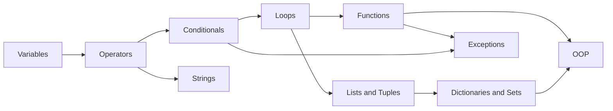
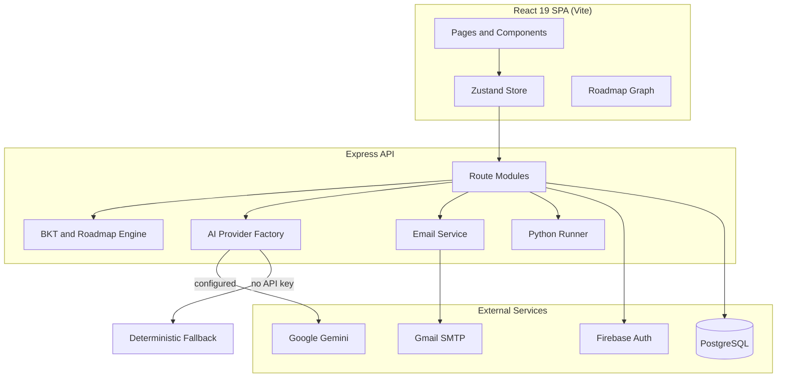

<div align="center">

# 🧠 LearnPath AI

**An adaptive Python learning platform built on Bayesian Knowledge Tracing and generative AI.**

React 19 · TypeScript · Vite · Express · Tailwind CSS · Google Gemini · PostgreSQL · Firebase

[🏆 Submission](#-submission-details) · [👥 Team](#-team-code-alchemists) · [📖 Overview](#-overview) · [✨ Features](#-features) · [🖼️ Product Tour](#️-product-tour) · [🔬 Methodology](#-methodology) · [🏗️ Architecture](#️-architecture) · [🚀 Getting Started](#-getting-started) · [📡 API](#-api-reference) · [🔒 Security](#-security) · [🧭 Roadmap](#-roadmap) · [🤖 AI Disclosure](#-ai-tools-models-apis-and-open-source-disclosure)


</div>

---

## 🏆 Submission Details

| | |
|---|---|
| **Project name** | LearnPath AI: Adaptive Python Learning |
| **Team name** | Code Alchemists |
| **Selected problem** | `[Adaptive Learning Path Generator]` |
| **Category** | `[EDUCATION]` |
| **Repository** | https://github.com/soomroabdulwasiu-blip/LearnPathAI---CodeAlchemists |

## 👥 Team Code Alchemists

| # | Member | GitHub |
|:-:|---|---|
| 1 | Abdul Wasiu | [@soomroabdulwasiu-blip](https://github.com/soomroabdulwasiu-blip) |
| 2 | Muhammad Farhan | [@K25SW01](https://github.com/K25SW01) |
| 3 | Engineer Jatoi | [@zaminjatoi4050-crypto](https://github.com/zaminjatoi4050-crypto) |

## 🎯 Problem Statement and Solution

### ❗ The Problem

Most Python courses give every learner the same fixed sequence of lessons. Beginners who already know a topic waste time, while those who are struggling move on before they understand the basics. Learners and instructors also have no reliable, quantitative view of what a student actually knows, and many learners need support in a language other than English.

### 💡 Our Solution

LearnPath AI measures each learner's knowledge and builds the study path around it:

- A short **diagnostic assessment** estimates starting mastery for ten core Python topics.
- **Bayesian Knowledge Tracing** updates that estimate after every practice answer.
- A **prerequisite graph** keeps the roadmap in a logical order: a topic stays locked until its foundations reach 50%, and mastered topics (85% and above) are skipped.
- An **AI tutor, Code Lab, and spaced review** help learners practice and fix weak areas.
- **Instructor heatmaps** and an **admin console** give teachers and administrators a clear view of progress.
- The interface is fully available in **English and Urdu**.

### 🧱 Technologies and Key Features

Technologies are listed in the [Technology Stack](#-technology-stack) and the features in [Features](#-features) and the [Product Tour](#️-product-tour) below.

---

## 📖 Overview

LearnPath AI replaces the fixed, one-size-fits-all syllabus with a personalized learning path. The platform measures what a learner already knows, models mastery of each topic probabilistically, and continuously regenerates a study roadmap around the learner's actual gaps.

The system:

1. 🔍 **Assesses** a learner's starting level with an adaptive diagnostic.
2. 🧮 **Models** per-topic mastery using Bayesian Knowledge Tracing (BKT).
3. 🗺️ **Plans** a roadmap over a prerequisite graph of ten core Python topics.
4. 🔄 **Adapts** after every practice answer, skipping mastered material and reinforcing weak areas.
5. 🤝 **Supports** learners with an AI tutor, an in-browser code lab, and spaced review.

The application is bilingual (English and Urdu), supports light and dark themes, and provides separate student, instructor, and administrator experiences.

---

## ✨ Features

### 🎓 Learner Experience

| Capability | Description |
|---|---|
| Adaptive diagnostic | Session-based placement assessment that seeds initial mastery for each topic |
| Personalized roadmap | Priority-ranked topics presented as an interactive graph, timeline, or weekly plan |
| Adaptive practice | Question selection driven by current mastery, with an immediate BKT update on each answer |
| Code Lab | Write and run Python against automated test cases |
| AI tutor | Conversational assistance in a slide-out drawer and a dedicated assistant page |
| Spaced review | Retention tracking with due, critical, and upcoming review queues |
| Progress tracking | Mastery charts, XP, levels, streaks, goals, and quiz history |
| Command palette | Keyboard navigation with `Ctrl/Cmd + K` |

### 🤖 AI Copilot

Powered by Google Gemini through a provider abstraction:

- 🐍 **Python tutor**: context-aware answers to programming questions
- 🎯 **Weak-topic analysis**: plain-language interpretation of mastery data
- ❓ **Question generation**: schema-validated multiple-choice practice questions
- 💡 **Mistake explanation**: targeted feedback on incorrect answers
- 📅 **Study plans**: schedules fitted to the learner's goal and weekly availability
- 🔎 **Code explanation**: step-by-step execution walkthroughs

> 💡 **Works without an API key.** If no `GEMINI_API_KEY` is configured, the platform falls back to a built-in deterministic engine so that all features remain available.

### 👩‍🏫 Instructor Tools

- Class creation with shareable join codes
- Class-wide mastery heatmap across students and topics
- Per-student detail views
- Content management

### 🛡️ Administration

- User management (create, edit, delete, password reset)
- Question bank and class management
- Direct mastery overrides, quiz oversight, platform statistics, and data export

### 🔐 Authentication

- Email and password registration, Google sign-in, and Firebase token login
- Email verification and password recovery through one-time passcodes delivered by Gmail (Nodemailer)
- Gmail sender configurable through environment variables or an in-app settings dialog
- Brute-force protection: three incorrect passcode attempts lock the account for two hours
- Passcodes expire after ten minutes
- Role-based route guards for `student`, `instructor`, and `admin`

---

## 🖼️ Product Tour

A walkthrough of the main screens, in the order a learner typically encounters them.

### 1. 🔐 Authentication

Sign in with email and password or Google. New accounts are verified with a one-time passcode.


Password recovery sends a six-digit verification code by email. The Gmail Sender Settings shortcut lets administrators configure the delivery account without editing environment files.


### 2. 📊 Dashboard

The overview page summarizes learning progress, skills mastered, study streak, and average quiz score, and recommends the next best step based on the current knowledge model.


### 3. 📝 Diagnostic Assessment

A placement assessment seeds the initial mastery estimate for each topic. Questions can include code snippets and are available in English and Urdu.


### 4. 🎯 Practice Center

Adaptive question sets target weak concepts. Each answer updates the Bayesian mastery estimate, and the progress ring shows the current score for the active topic.


### 5. 💬 AI Tutor

A context-aware tutor opens beside the current question. It knows which question is active and offers suggested prompts. When no Gemini key is configured, the local Socratic engine responds instead.


### 6. 💻 Code Lab

An interactive editor runs Python against optional test cases, with standard input support, a reset control, and an "Explain with AI" action. Guided challenges sit alongside a free playground.


### 7. 📈 Progress and Analytics

Overall competency, topic mastery rate, study streak, assessment score history, and daily study distribution are tracked over time.


### 8. 👩‍🏫 Instructor Portal

Instructors create class cohorts that generate join codes for student registration and monitor competency through class heatmaps.


The Content Manager lets instructors browse, filter, add, and remove questions by topic and difficulty.


### 9. 🛡️ Administration

Administrators manage users, the question bank, classes, quiz attempts, and topic mastery from a single console, with live database connection status.


---

## 🔬 Methodology

### 🧮 Bayesian Knowledge Tracing

Each answer updates the learner's estimated probability of mastery, `P(L)`, for the relevant topic:

```
Correct answer:    P(L | obs) = P(L)(1 - S) / [ P(L)(1 - S) + (1 - P(L))G ]
Incorrect answer:  P(L | obs) = P(L)S / [ P(L)S + (1 - P(L))(1 - G) ]

Learning update:   P(L_next) = P(L | obs) + (1 - P(L | obs)) T
```

| Parameter | Description | Default |
|---|---|---|
| `P(L0)` | Initial probability of knowing the topic | 0.25 |
| `P(T)` | Probability of learning at each step | 0.18 |
| `P(G)` | Probability of a correct guess | 0.20 |
| `P(S)` | Probability of a slip on known material | 0.12 |

Mastery scores are bounded between 5% and 98% and returned with a confidence value.

### 🚦 Topic Status

Each topic is classified from its mastery score and the state of its prerequisites:

| Status | Condition |
|---|---|
| Locked | A prerequisite is below 50% |
| Learn | Mastery below 40% |
| Practice | Mastery from 40% to below 68% |
| Review | Mastery from 68% to below 85% |
| Skip | Mastery of 85% or higher |

### 🗺️ Roadmap Generation

The roadmap engine assigns each topic a priority score. Low mastery increases priority, while locked and mastered topics are deprioritized; topological order resolves ties. Estimated study time is then scaled by status (review at 40%, practice at 70%, skip at zero) and converted to week numbers using the learner's weekly hours. Every item includes a rationale in English and Urdu, and each response includes a diff against the previous roadmap.

### 🔗 Prerequisite Graph



---

## 🏗️ Architecture



A single Express process serves both the API and the frontend. In development, Vite is mounted as middleware with hot module replacement. In production, the process serves the compiled `dist/` directory.

### 🔌 AI Provider Design

An `AIProvider` interface is implemented by `GeminiProvider` and `DeterministicFallbackProvider`. `AIProviderFactory` selects the active provider at runtime and exposes its status via `/api/health` and `/api/ai/status`. Each capability is isolated in its own service module, and a validator normalizes model output (for example, generated questions) before it reaches the learner.

### 🧰 Technology Stack

| Layer | Technologies |
|---|---|
| Frontend | React 19, TypeScript, Vite, React Router 7, Zustand, Tailwind CSS 4 |
| Interface | Motion, Recharts, @xyflow/react, Lucide, Sonner |
| Backend | Node.js, Express 4, tsx |
| Database | PostgreSQL with Drizzle ORM and `pg`, backed by an in-memory cache |
| Authentication | Firebase Auth and Admin, HMAC-signed tokens, PBKDF2 password hashing |
| Email | Nodemailer with Gmail App Passwords |
| AI | Google Gemini via `@google/genai` |

---

## 📁 Project Structure

```
.
├── server.ts                  Express entry point (API and Vite middleware)
├── index.html                 Application shell and metadata
├── vite.config.ts             Vite, React, and Tailwind configuration
├── .env.example               Environment variable template
└── src/
    ├── App.tsx                Routing and protected-route guards
    ├── pages/                 Route-level screens
    ├── components/
    │   ├── ai/                AI Copilot panel
    │   ├── auth/              OTP input, Gmail configuration dialog
    │   ├── layout/            Header, sidebar, mobile navigation, footer
    │   ├── roadmap/           Graph, timeline, and weekly views
    │   ├── tutor/             Tutor drawer
    │   └── ui/                Shared primitives and command palette
    ├── server/
    │   ├── routes/            Auth, diagnostic, mastery, roadmap, practice,
    │   │                      review, instructor, history, ai, admin, python
    │   ├── engine/            bkt.ts and roadmap.ts (adaptive logic)
    │   ├── ai/                Factory, providers, services, validator
    │   ├── services/          Email delivery
    │   ├── middleware/        Authentication and authorization
    │   └── db/                Data store with PostgreSQL synchronization
    ├── db/                    Drizzle schema, connection pool, configuration
    ├── data/                  Seed questions, lessons, and challenges
    ├── lib/                   Topic graph, storage, utilities
    ├── i18n/                  English and Urdu translations
    ├── store/                 Global state
    └── types/                 Shared TypeScript types
```

---

## 🚀 Getting Started

### ✅ Prerequisites

- Node.js 20 or later (or Bun)
- Python 3 available on `PATH` (required by the Code Lab)
- Optional: a Gemini API key, a Gmail App Password, and a PostgreSQL instance

### 📦 Installation

```bash
git clone https://github.com/<your-username>/LearnPathAI---CodeAlchemists.git
cd LearnPathAI---CodeAlchemists
npm install
cp .env.example .env
```

### ⚙️ Configuration

| Variable | Required | Description |
|---|:---:|---|
| `GEMINI_API_KEY` | No | Enables live Gemini responses; omitted, the fallback engine is used |
| `GEMINI_MODEL` | No | Overrides the default Gemini model |
| `AI_TIMEOUT_MS` | No | AI request timeout in milliseconds (default `15000`) |
| `GMAIL_USER` | No | Gmail address used to send verification emails |
| `GMAIL_APP_PASSWORD` | No | 16-character [Google App Password](https://myaccount.google.com/apppasswords) |
| `JWT_SECRET` | Recommended | Secret for signing session tokens; required for any production deployment |
| `SQL_HOST`, `SQL_USER`, `SQL_PASSWORD`, `SQL_DB_NAME` | No | PostgreSQL connection settings |
| `APP_URL` | No | Public URL of the deployed application |
| `PORT` | No | Server port (default `3000`) |

> 📧 **Tip:** Gmail credentials can alternatively be entered through the in-app Gmail Sender Settings dialog.

### ▶️ Running

```bash
npm run dev                       # Development server with hot reload
npm run lint                      # Type check
npm run build                     # Production build
NODE_ENV=production npm start     # Serve the production build
```

🌐 The application is available at `http://localhost:3000`, and service status at `http://localhost:3000/api/health`.

---

## 📡 API Reference

All endpoints are prefixed with `/api`. Protected endpoints require an `Authorization: Bearer <token>` header.

<details>
<summary><strong>🔐 Authentication</strong> (<code>/api/auth</code>)</summary>

| Method | Endpoint | Purpose |
|---|---|---|
| POST | `/signup` | Register with email verification |
| POST | `/login` | Email and password login |
| POST | `/google-login` | Google sign-in |
| POST | `/firebase-login` | Firebase ID token login |
| POST | `/logout` | End the session |
| GET | `/me` | Current user profile |
| GET | `/freeze-status` | Check whether an email is locked |
| POST | `/forgot-password/request-otp` | Begin password recovery |
| POST | `/forgot-password/verify-otp` | Verify a recovery code |
| POST | `/forgot-password/resend-otp` | Resend a recovery code |
| POST | `/forgot-password/reset` | Set a new password |
| GET, POST | `/gmail-config/status`, `/save`, `/test` | Manage the Gmail sender |

</details>

<details>
<summary><strong>🎯 Learning engine</strong></summary>

| Method | Endpoint | Purpose |
|---|---|---|
| POST | `/diagnostic/start` | Start a diagnostic session |
| POST | `/diagnostic/answer` | Submit a diagnostic answer |
| GET | `/mastery` | Per-topic mastery map |
| GET | `/roadmap` | Personalized roadmap and diff |
| GET | `/practice/next` | Next adaptive question |
| POST | `/practice/submit` | Submit an answer and update mastery |
| GET | `/review/due` | Spaced-review queue |
| GET | `/history`, `/history/activities` | Quiz history and activity feed |

</details>

<details>
<summary><strong>🤖 AI and code execution</strong></summary>

| Method | Endpoint | Purpose |
|---|---|---|
| GET | `/ai/status` | Active provider and model |
| POST | `/ai/tutor` | Tutor conversation |
| POST | `/ai/explain-weak-topics` | Weak-topic analysis |
| POST | `/ai/generate-questions` | Generate practice questions |
| POST | `/ai/explain-mistake` | Explain an incorrect answer |
| POST | `/ai/study-plan` | Generate a study plan |
| POST | `/ai/explain-code` | Explain a code snippet |
| POST | `/python/run` | Execute Python against test cases |

</details>

<details>
<summary><strong>👩‍🏫 Instructor and administration</strong></summary>

| Area | Endpoints |
|---|---|
| Instructor | `GET, POST /instructor/classes`; `GET /instructor/classes/:id/heatmap`; `GET /instructor/students/:id` |
| Admin | CRUD under `/admin/users`, `/admin/classes`, `/admin/questions`; `GET /admin/stats`, `/admin/quizzes`, `/admin/export`; `PUT /admin/mastery/:userId/:topicId` |

</details>

---

## 🗄️ Data Model

Defined with Drizzle ORM in `src/db/schema.ts`.

| Table | Purpose |
|---|---|
| `users` | Profiles, roles, XP, level, streak, class code, credentials |
| `user_mastery` | Mastery score per user and topic |
| `roadmaps` | Stored roadmap items and time estimates |
| `quiz_history` | Assessment results with topic breakdown |
| `recent_activities` | Activity feed |
| `classes` | Instructor classes and join codes |
| `diagnostic_sessions` | Placement test sessions |
| `otp_records` | One-time passcodes and attempt counters |
| `reset_tokens` | Password-reset tokens |
| `frozen_accounts` | Temporary lockouts |
| `questions` | Question bank with Urdu translations |

---

## 🔒 Security

### 🧪 Code Execution

The Code Lab runs submitted Python via `POST /api/python/run` in a separate `python3` child process with the following controls:

- Minimal environment, so server secrets are not inherited
- Execution timeout between 1 and 10 seconds, enforced with `SIGKILL`
- 64 KB limit on submitted code and 128 KB cap on captured output

> ⚠️ **Note:** This is process-level isolation, not a complete sandbox. For any public deployment, run the service in a container or virtual machine with no network access, a read-only filesystem, and CPU and memory limits.

### 📋 Pre-Deployment Checklist

- [ ] Set a strong, unique `JWT_SECRET`; a development fallback exists in the code
- [ ] Remove or replace the seeded demo accounts in `src/server/db/store.ts`
- [ ] Increase the PBKDF2 iteration count (currently 1,000) or migrate to scrypt or Argon2
- [ ] Add token expiry validation and rate limiting on authentication routes
- [ ] Exclude `.env` and `data/gmail_credentials.json` from version control
- [ ] Restrict Firebase API keys by domain and review `firebase-applet-config.json`
- [ ] Isolate the Python runner in a hardened container

---

## 🌍 Internationalization

The interface, topic titles and descriptions, quiz questions, explanations, and roadmap rationales are available in English and Urdu. The language preference is stored per user.

---

## 🧭 Roadmap

- [ ] Persist spaced-repetition schedules per user (currently a demonstration queue)
- [ ] Additional tracks: JavaScript, SQL, and data science
- [ ] Fit BKT parameters per topic from real response data
- [ ] Expanded question bank and lesson content
- [ ] Automated test suite and continuous integration
- [ ] Dockerfile and cloud deployment guide
- [ ] Badges, leaderboards, and class challenges

---

## 🧗 Challenges and Learnings

### Challenges

- **Making the adaptive model trustworthy.** Implementing BKT correctly, keeping scores in a sensible range, and turning them into topic statuses and a roadmap required careful tuning of guess, slip, and learning parameters.
- **Reliable AI output.** Language models can return malformed or unsafe content. We added a validator that checks and normalizes generated questions, plus a deterministic fallback so the app still works with no API key or when the model is slow.
- **Secure authentication.** Building email verification with one-time passcodes meant handling expiry, attempt limits, account lockouts, and delivery through Gmail.
- **Running user code safely.** The Code Lab needed timeouts, output limits, and a stripped-down environment to reduce the risk of running untrusted Python.
- **Bilingual content.** Supporting Urdu meant translating questions, explanations, and roadmap rationales, not just interface labels.

### Learnings

- Practical use of probabilistic student modeling in a real product
- Designing an AI provider abstraction with a graceful fallback
- Full-stack TypeScript development with React, Express, and PostgreSQL
- Security fundamentals for authentication and code execution
- Working as a team on a shared repository

---

## 🤖 AI Tools, Models, APIs, and Open-Source Disclosure

### AI Models and APIs

| Tool | How it is used |
|---|---|
| **Google Gemini API** (`@google/genai`) | Runtime AI features: tutor, weak-topic analysis, question generation, mistake explanation, study plans, and code explanation. The model name is configurable with `GEMINI_MODEL`. |
| **Deterministic fallback engine** | Rule-based replacement written by the team, used when no Gemini key is configured |

### AI-Assisted Development

| Tool | How it was used |
|---|---|
| **Google AI Studio (Build)** | The project was created as an AI Studio applet, as shown by its original README and `metadata.json`. |
| **Claude (Anthropic)** | Helped draft and structure this README. |
| `[FILL IN]` | Add any other AI assistants the team used (for example ChatGPT or GitHub Copilot) and what for. |

### External Services

| Service | Purpose |
|---|---|
| Firebase Authentication | Google and Firebase sign-in |
| Gmail SMTP through Nodemailer | One-time passcode emails |
| PostgreSQL (Cloud SQL) | Data persistence |
| Google Fonts | Outfit, Plus Jakarta Sans, and JetBrains Mono typefaces |

### Open-Source Libraries

React, React Router, Vite, Express, Tailwind CSS, Zustand, Drizzle ORM, node-postgres (`pg`), Nodemailer, Firebase SDK and Admin SDK, Recharts, @xyflow/react, Motion, Lucide React, Sonner, canvas-confetti, dotenv, clsx, tailwind-merge, tsx, and TypeScript. Each is used under its own license; see `package.json` for exact versions.

### Algorithms and Research

Bayesian Knowledge Tracing is a published student-modeling technique (Corbett and Anderson, 1995). The implementation in `src/server/engine/bkt.ts` was written for this project.

---

## 🔗 Repository

**Main project repository:** https://github.com/`<owner-username>`/LearnPathAI---CodeAlchemists

---

## 🤝 Contributing

Contributions are welcome.

1. Fork the repository.
2. Create a feature branch: `git checkout -b feature/your-feature`.
3. Commit your changes with a clear message.
4. Push the branch and open a pull request.

Please run `npm run lint` before submitting.

---

## 📄 License

No license file is currently included. Add one (for example, MIT) before distributing this project.
